<h1 align="center">
  <picture>
    <source media="(prefers-color-scheme: dark)" srcset="apps/docs/src/assets/brand/fiatdesk-logo-white.svg">
    
  </picture>
</h1>

<h3 align="center">Open-source stablecoin payment processing platform</h3>

<p align="center">
  <a href="./LICENSE"></a>
  
  
</p>

<p align="center">
  <a href="#quick-start">Quick start</a> ·
  <a href="#setup-guide">Setup guide</a> ·
  <a href="apps/docs">Documentation</a> ·
  <a href="#a-familiar-api">API</a>
</p>

<p align="center">
  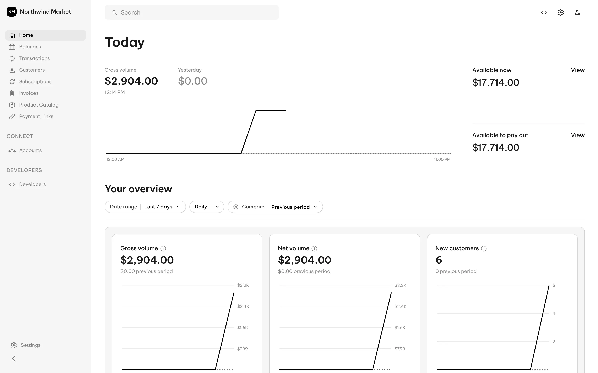
</p>

---

<!-- prettier-ignore -->
> [!WARNING]
> **Not yet production-ready.** FiatDesk's smart contracts (`PayoutBatch` and `Subscriptions`) have not been independently audited, and the full payment flow has not yet been run on a public network. Use test mode, a local Anvil chain or Sepolia, and do not process real funds until the contracts are audited. See [Before you go live](#before-you-go-live).

FiatDesk is a self-hosted payment processor for stablecoins. Run it for your own business, or as the payments layer of a marketplace: hosted checkout, payment links, recurring billing, connected seller accounts, payouts and webhooks, all settled in USDC on Ethereum.

## Why FiatDesk

- **You run it.** Deploy with Docker on your own servers. Your platform wallet's key never touches the server, so funds stay in your custody.
- **A Stripe-compatible API.** Checkout Sessions, Payment Links, Customers, Subscriptions, Accounts, Transfers and Payouts, with the same object shapes, webhooks and idempotency model.
- **Gas-free checkout for buyers.** Customers sign one USDC authorization (EIP-3009); your relayer submits it and pays the gas.
- **Recurring billing on-chain.** Subscribers approve a capped allowance once, and renewals are collected each period without another signature.
- **Batch payouts.** Pay many sellers in one transaction through the `PayoutBatch` contract, so they share the gas.
- **No percentage fees.** FiatDesk takes no cut. Your only costs are Ethereum gas and your hosting.

## Screenshots

Every screenshot comes from a running FiatDesk instance with demo data. Click one to open it at full resolution (2880×1800).

### Payments

<table>
  <tr>
    <td width="50%" valign="top">
      <a href="docs/screenshots/checkout.webp">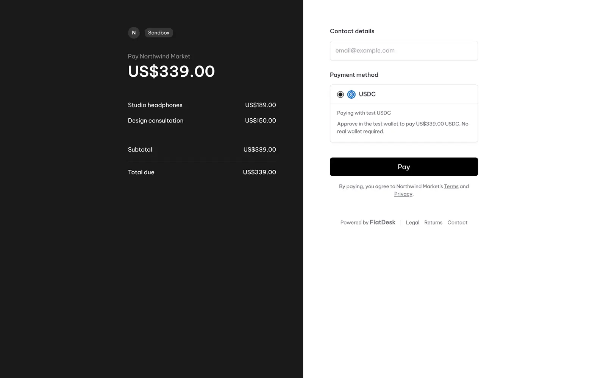</a>
      <br><b>Hosted checkout</b><br>Buyers connect a wallet and sign once to pay in USDC. Your relayer pays the gas.
    </td>
    <td width="50%" valign="top">
      <a href="docs/screenshots/dashboard-payment-links.webp">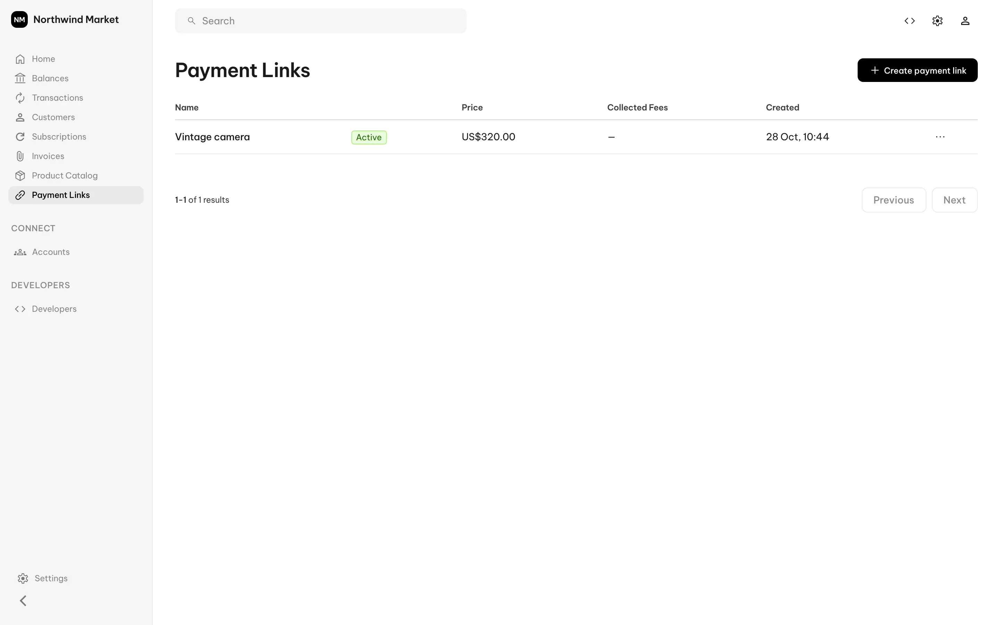</a>
      <br><b>Payment links</b><br>Shareable links that open hosted checkout, with no code.
    </td>
  </tr>
  <tr>
    <td width="50%" valign="top">
      <a href="docs/screenshots/dashboard-products.webp">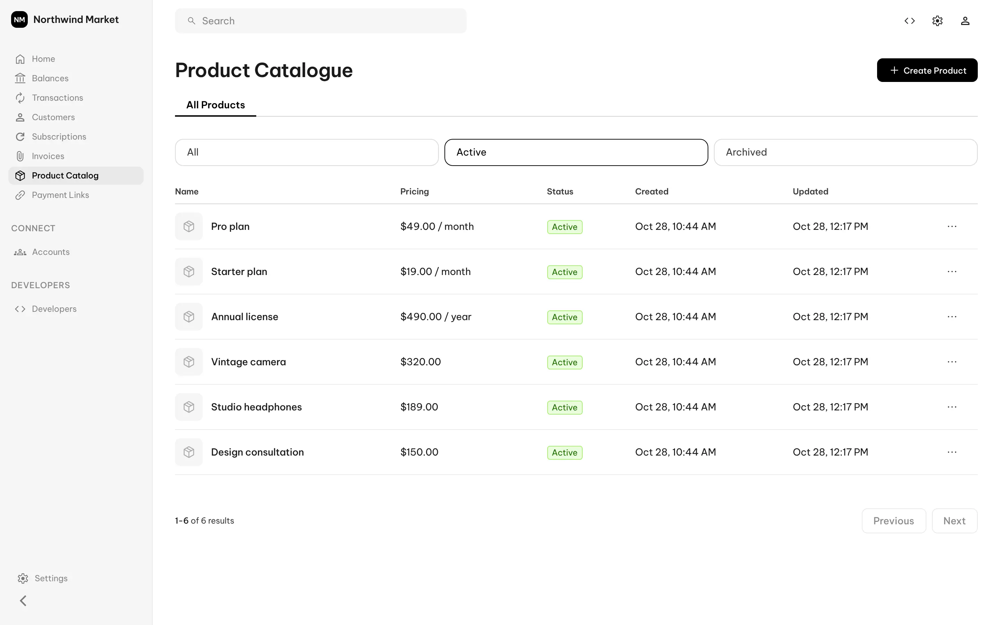</a>
      <br><b>Product catalog</b><br>Products with one-time and recurring USDC prices.
    </td>
    <td width="50%" valign="top">
      <a href="docs/screenshots/dashboard-transactions.webp">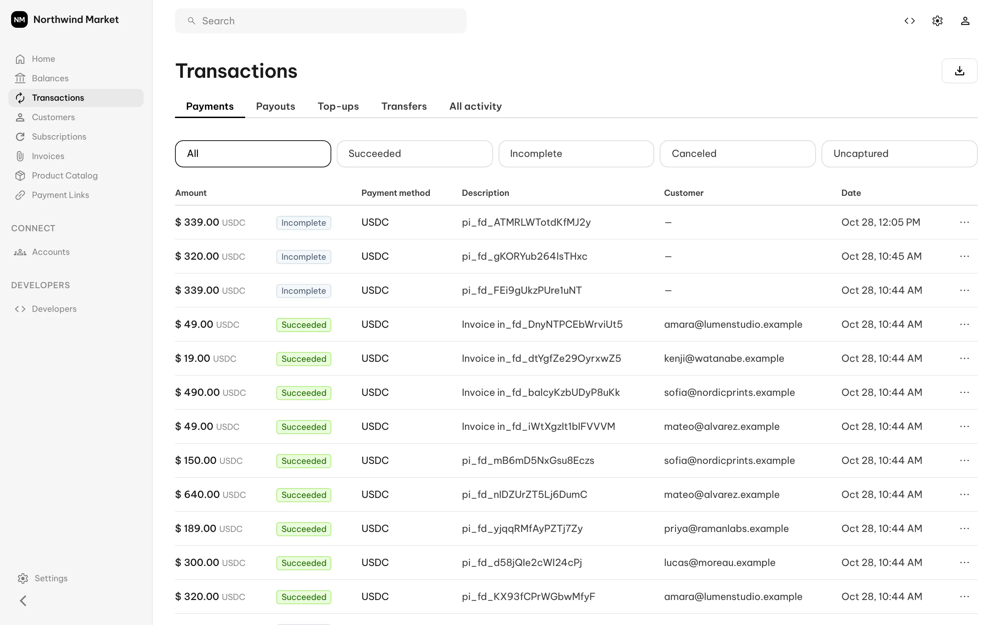</a>
      <br><b>Transactions</b><br>Payments, payouts, top-ups and transfers, filterable and exportable.
    </td>
  </tr>
</table>

### Billing

<table>
  <tr>
    <td width="50%" valign="top">
      <a href="docs/screenshots/dashboard-subscriptions.webp">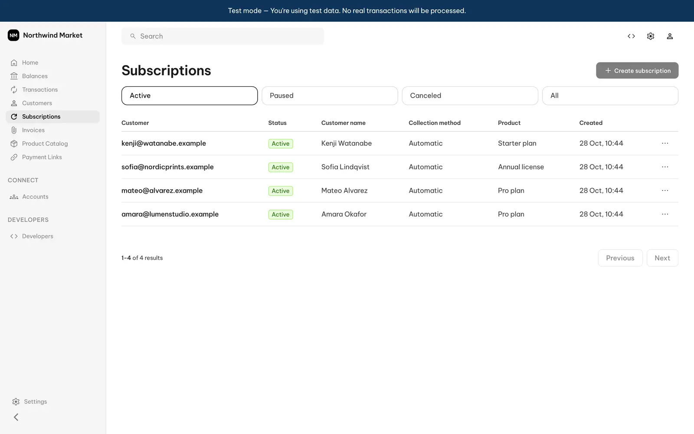</a>
      <br><b>Subscriptions</b><br>Monthly and yearly plans renewed on-chain without another signature.
    </td>
    <td width="50%" valign="top">
      <a href="docs/screenshots/dashboard-invoices.webp">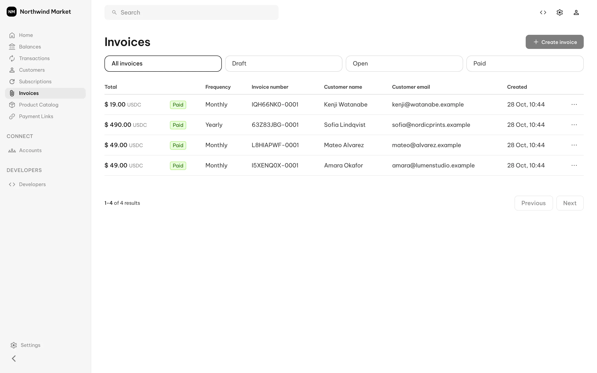</a>
      <br><b>Invoices</b><br>Invoices created and paid by each billing cycle.
    </td>
  </tr>
  <tr>
    <td width="50%" valign="top">
      <a href="docs/screenshots/dashboard-customers.webp">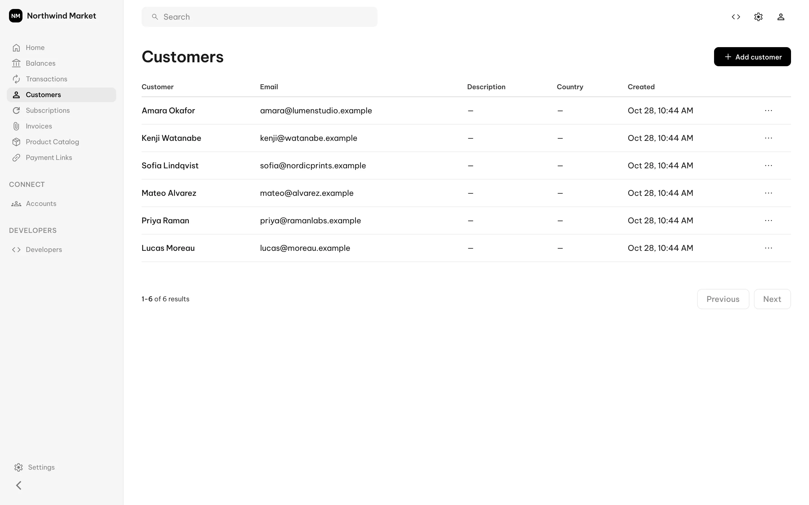</a>
      <br><b>Customers</b><br>Everyone who has paid you, with their contact details.
    </td>
    <td width="50%" valign="top">
      <a href="docs/screenshots/dashboard-customer-detail.webp">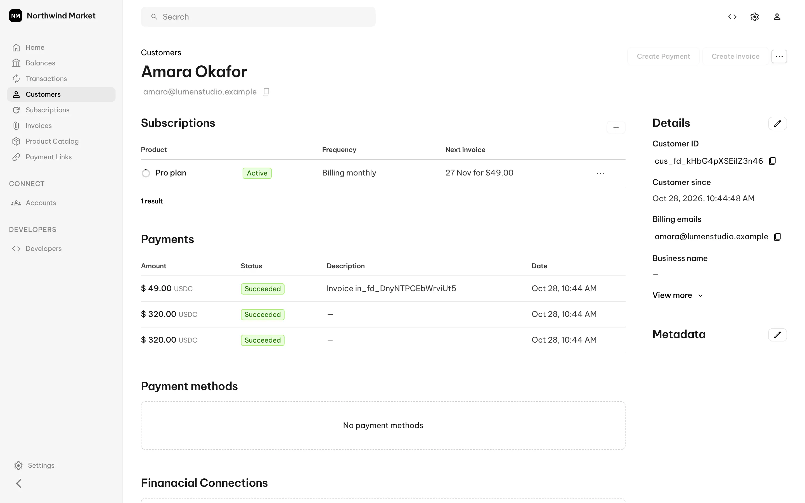</a>
      <br><b>Customer detail</b><br>A customer's subscriptions, payments and invoices on one page.
    </td>
  </tr>
</table>

### Marketplaces

<table>
  <tr>
    <td width="50%" valign="top">
      <a href="docs/screenshots/dashboard-connected-accounts.webp">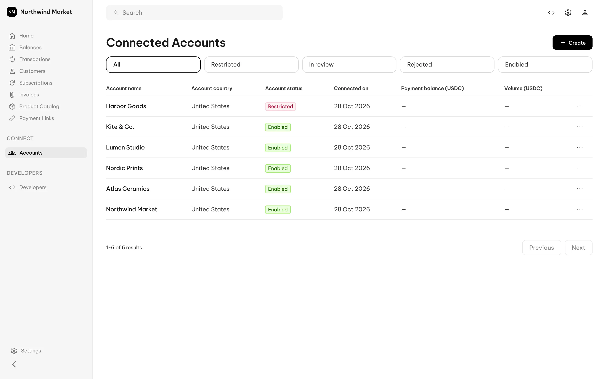</a>
      <br><b>Connected accounts</b><br>Your sellers and their onboarding status.
    </td>
    <td width="50%" valign="top">
      <a href="docs/screenshots/dashboard-connected-account-detail.webp">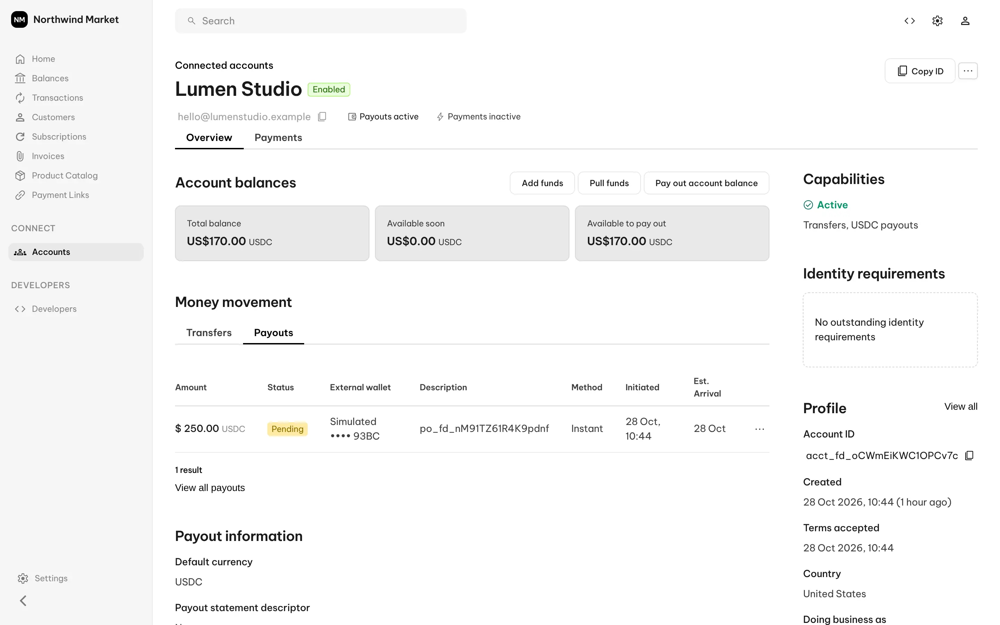</a>
      <br><b>Connected account detail</b><br>Balances, transfers, payouts, capabilities and identity checks for one seller.
    </td>
  </tr>
  <tr>
    <td width="50%" valign="top">
      <a href="docs/screenshots/seller-onboarding.webp">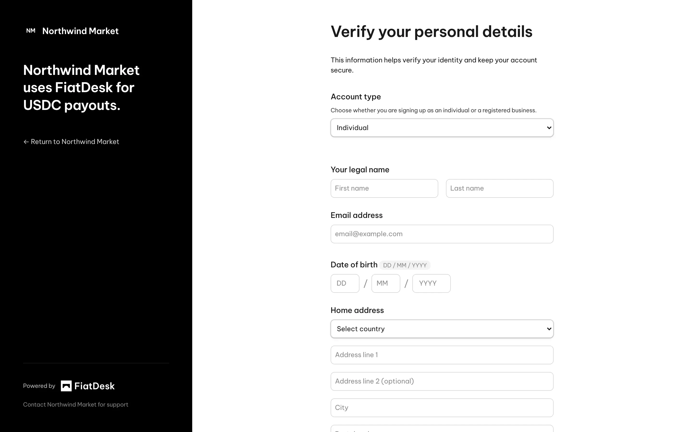</a>
      <br><b>Seller onboarding</b><br>A hosted flow where sellers enter their details and connect a wallet.
    </td>
    <td width="50%" valign="top">
      <a href="docs/screenshots/seller-dashboard.webp">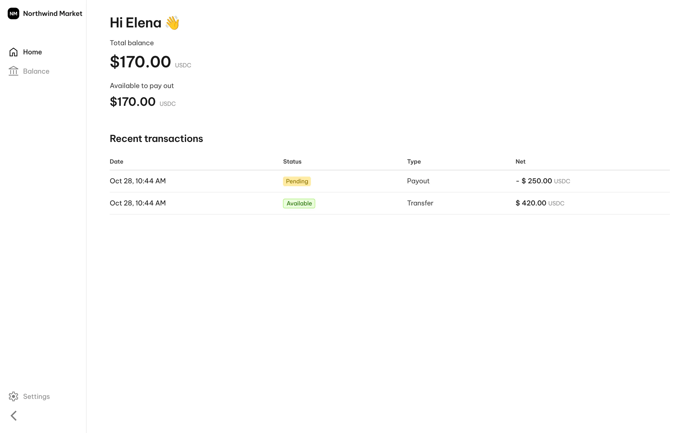</a>
      <br><b>Seller dashboard</b><br>Each seller's own view of their balance, payouts and transfers.
    </td>
  </tr>
</table>

### Platform

<table>
  <tr>
    <td width="50%" valign="top">
      <a href="docs/screenshots/dashboard-home.webp"></a>
      <br><b>Home</b><br>Today's volume, available balance and trends over time.
    </td>
    <td width="50%" valign="top">
      <a href="docs/screenshots/dashboard-balances.webp">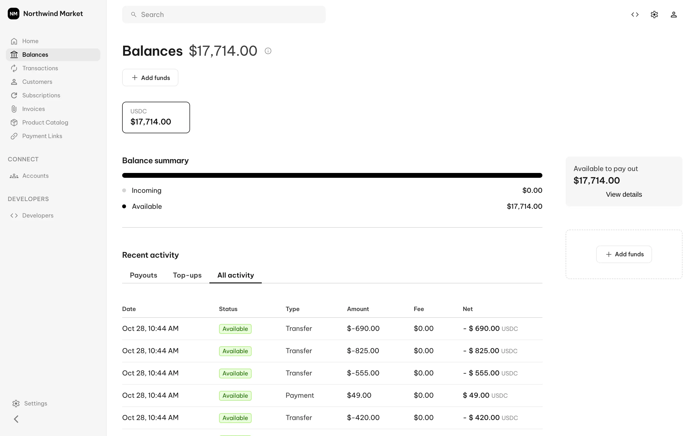</a>
      <br><b>Balances</b><br>Your USDC balance, what can be paid out, and every balance movement.
    </td>
  </tr>
  <tr>
    <td width="50%" valign="top">
      <a href="docs/screenshots/dashboard-developers.webp">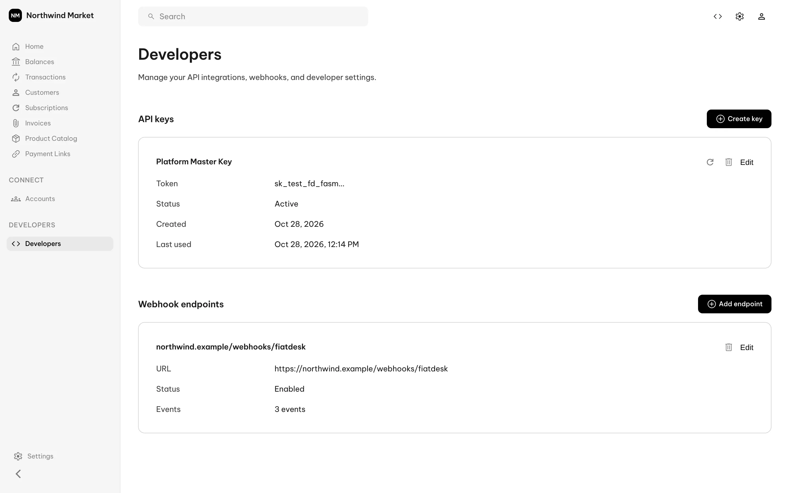</a>
      <br><b>Developers</b><br>API keys and webhook endpoints.
    </td>
    <td width="50%" valign="top">
      <a href="docs/screenshots/dashboard-settings.webp">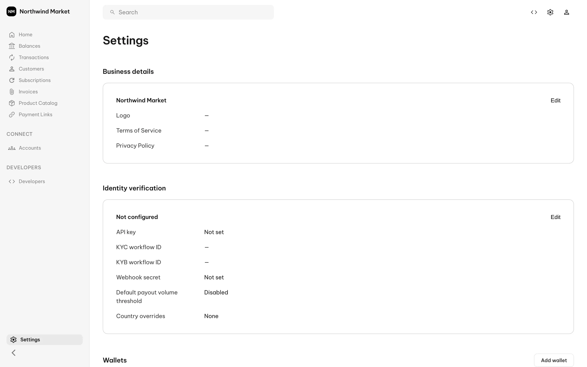</a>
      <br><b>Settings</b><br>Business details, identity verification rules and platform wallets.
    </td>
  </tr>
</table>

### Documentation

<table>
  <tr>
    <td width="50%" valign="top">
      <a href="docs/screenshots/docs-quickstart.webp">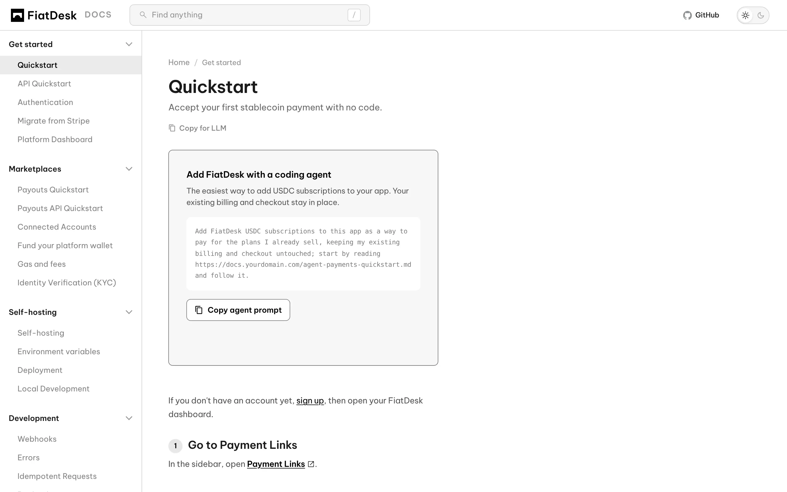</a>
      <br><b>Guides</b><br>Quickstarts for payments, marketplaces, self-hosting and webhooks.
    </td>
    <td width="50%" valign="top">
      <a href="docs/screenshots/docs-api-reference.webp">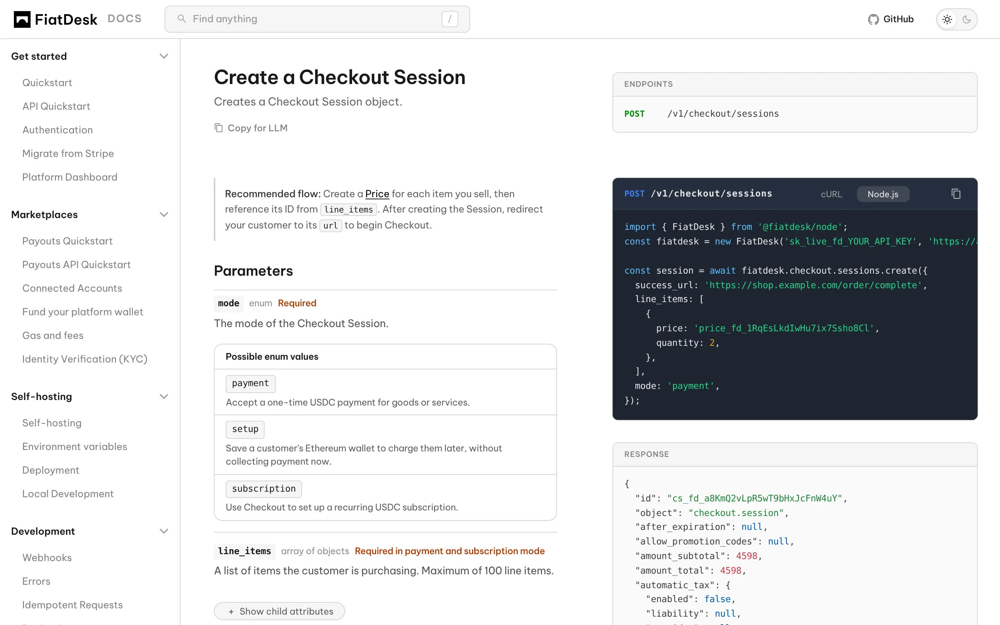</a>
      <br><b>API reference</b><br>Every endpoint, with parameters, cURL and Node.js examples, and sample responses.
    </td>
  </tr>
</table>

## A familiar API

FiatDesk uses familiar resources such as Checkout Sessions, Payment Links, Customers, Products, Subscriptions, Accounts, Transfers, and Payouts. It also follows Stripe's object shapes, webhook patterns, and idempotency model.

If you have worked with Stripe before, the SDK should feel familiar:

```typescript
import { FiatDesk } from '@fiatdesk/node';
const client = new FiatDesk('sk_live_fd_YOUR_API_KEY', 'https://api.yourdomain.com');

const session = await client.checkout.sessions.create({
  success_url: 'https://yoursite.com/success',
  cancel_url: 'https://yoursite.com/cancel',
  line_items: [
    {
      price_data: {
        currency: 'usdc',
        unit_amount: 1000,
        product_data: { name: 'My first product' },
      },
      quantity: 1,
    },
  ],
  mode: 'payment',
});
```

The API covers checkout, subscriptions, and marketplace payouts. See the [API reference](apps/docs) for the full list of resources and endpoints.

## Quick start

Everything runs in Docker. Clone the repository with its contract dependencies:

```bash
git clone --recursive https://github.com/fiatdesk/payment-processor.git
cd payment-processor
```

Then pick a mode. Each one is a single command, and the dashboard opens at [localhost](http://localhost). Go to [localhost/setup](http://localhost/setup) to create your platform account and API key.

| Mode                                                  | Command                                                                  | Good for                                                                          |
| ----------------------------------------------------- | ------------------------------------------------------------------------ | --------------------------------------------------------------------------------- |
| [Simulated funds](#simulated-funds-default) (default) | `docker compose up -d`                                                   | Trying the dashboard, API and SDK in two minutes                                  |
| [Local chain](#local-chain)                           | `docker compose -f docker-compose.yml -f docker-compose.anvil.yml up -d` | Real on-chain flows (signing, payout batches, renewals) with no faucet or RPC key |
| [Sepolia](#sepolia)                                   | `docker compose up -d` with Sepolia settings in `.env`                   | Testing on a public testnet                                                       |

All modes share one database, so start from a clean one when you switch: `docker compose down -v` deletes all local data.

### Simulated funds (default)

```bash
docker compose up -d
```

No RPC, keys or ETH needed. Balances are ledger entries with no chain behind them. Credit test USDC from **Balances → Add funds**, or with `POST /v1/test_helpers/treasury/topups`.

### Local chain

```bash
docker compose -f docker-compose.yml -f docker-compose.anvil.yml up -d
docker compose -f docker-compose.yml -f docker-compose.anvil.yml logs chain-setup
```

This adds a local [Anvil](https://getfoundry.sh) chain (chain ID `31337`, RPC `http://localhost:8545`). A one-time container deploys test USDC, `PayoutBatch` and `Subscriptions`, mints 10,000 test USDC to two of Anvil's public test accounts, and the API settles on that chain. The logs print the addresses and keys:

- **Platform wallet** `0x70997970C51812dc3A010C7d01b50e0d17dc79C8`: enter it at `/setup`, and import its key into MetaMask to sign payouts from the dashboard.
- **Buyer wallet** `0x3C44CdDdB6a900fa2b585dd299e03d12FA4293BC`: import its key into MetaMask to pay at checkout.

The first time the dashboard or checkout asks MetaMask to sign, it offers to add the local chain. Top-ups are detected and subscriptions renew automatically. Reset the chain with `docker compose -f docker-compose.yml -f docker-compose.anvil.yml down -v`.

> These are Anvil's public test keys. Anyone can use them, so never send real funds to these addresses.

### Sepolia

Put your Sepolia settings in `.env`, then start as usual:

```bash
SETTLEMENT_RAIL=onchain
ETH_RPC_URL=https://your-sepolia-rpc-url
CHECKOUT_RELAYER_KEY=0x...        # pays checkout gas; holds Sepolia ETH only
SUBSCRIPTION_OPERATOR_KEY=0x...   # collects renewals; holds Sepolia ETH only
PAYOUT_BATCH_ADDRESS=0x...        # your PayoutBatch deployment
SUBSCRIPTIONS_ADDRESS=0x...       # your Subscriptions deployment
```

```bash
docker compose up -d
```

Sepolia USDC is preset. Shared Sepolia deployments of `PayoutBatch` and `Subscriptions` are not published yet, so for now deploy your own (see [Deploy the contracts](#4-deploy-the-contracts)). Get test USDC from the [Circle faucet](https://faucet.circle.com/) and a little Sepolia ETH for the platform wallet, relayer and operator.

## Setup guide

Follow these steps to settle real transactions, on Sepolia first and then on mainnet.

### 1. Choose a mode

| Mode              | Settings                                    | Money                          |
| ----------------- | ------------------------------------------- | ------------------------------ |
| Test, simulated   | defaults                                    | Fake ledger balances, no chain |
| Test, on Sepolia  | `LIVEMODE=false`, `SETTLEMENT_RAIL=onchain` | Sepolia USDC and Sepolia ETH   |
| Test, local Anvil | `docker-compose.anvil.yml` sets everything  | Test USDC it deploys for you   |
| Live, on mainnet  | `LIVEMODE=true`                             | Real USDC and ETH              |

Copy [`.env.production.example`](.env.production.example) to `.env.production` (or [`.env.example`](.env.example) to `.env` for local development). Every variable is described there.

### 2. Get an RPC endpoint

Set `ETH_RPC_URL` to a Sepolia or mainnet JSON-RPC URL from your node provider. Separate several URLs with commas: the first is the primary and the rest are fallbacks. A public RPC is fine for Sepolia but not for production.

### 3. Create the keys

FiatDesk uses four Ethereum accounts. Create each one with `cast wallet new` (Foundry), or in a wallet you control:

| Account               | Where its key lives                                                                                                      | Holds                          |
| --------------------- | ------------------------------------------------------------------------------------------------------------------------ | ------------------------------ |
| Platform wallet       | Never on the server: your browser wallet (dashboard), or `WALLET_PRIVATE_KEY` in the Node SDK process that signs payouts | USDC to pay out, ETH for gas   |
| Checkout relayer      | `CHECKOUT_RELAYER_KEY` on the API host                                                                                   | ETH only: it pays checkout gas |
| Subscription operator | `SUBSCRIPTION_OPERATOR_KEY` on the API host                                                                              | ETH only: it collects renewals |
| Deployer              | Your own machine, once (a keystore or hardware wallet)                                                                   | ETH to deploy the contracts    |

The relayer and operator keys can only relay what buyers sign, or pull at most a plan's amount per period to the plan's destination. Keep only gas money on them. Keep the same `SUBSCRIPTION_OPERATOR_KEY` for good: existing plans are owned by it.

### 4. Deploy the contracts

USDC is preset for Sepolia and mainnet. `PayoutBatch` and `Subscriptions` are not deployed for you. Deploy them with Foundry (see [`contracts/README.md`](contracts/README.md)):

```bash
git submodule update --init
cd contracts
forge script script/DeployPayoutBatch.s.sol --rpc-url "$ETH_RPC_URL" --account deployer --broadcast
forge script script/DeploySubscriptions.s.sol --rpc-url "$ETH_RPC_URL" --account deployer --broadcast
```

Set `PAYOUT_BATCH_ADDRESS` and `SUBSCRIPTIONS_ADDRESS` to the logged addresses. The [local chain](#local-chain) mode deploys everything for you.

### 5. Fund the accounts

- **Sepolia:** get test USDC from the [Circle faucet](https://faucet.circle.com/) (select USDC and Ethereum Sepolia) for the platform wallet and a buyer wallet. Send a little Sepolia ETH to the platform wallet, the relayer and the operator. Never send real funds to a test wallet.
- **Mainnet:** send USDC and ETH to the platform wallet, and ETH to the relayer and the operator. Watch their ETH balances: checkout and renewals stop when a key runs out of gas.

### 6. Start FiatDesk and run setup

```bash
npm run prod
```

Open `/setup` on your `DASHBOARD_URL` and enter the platform wallet's address. That wallet becomes the platform's default wallet. You can add more wallets and switch the default later from **Settings → Wallets**.

### 7. Schedule the background work

These jobs are off by default, because several API instances would each run them:

- **Deposits:** call `POST /v1/topups/check-deposits` when you expect USDC to arrive, or set `TOPUP_MONITOR_ENABLED=true` on a single instance.
- **Subscription billing:** call `POST /v1/billing/run_for_platform` with your platform API key from a scheduler, or set `BILLING_MONITOR_ENABLED=true` on a single instance.

### Before you go live

Get an independent security audit of `contracts/src/Subscriptions.sol` and `contracts/src/PayoutBatch.sol` before deploying them to mainnet, and run the whole flow on Sepolia first. As the operator, you carry the money-transmission, AML/KYC and sanctions obligations of your jurisdiction.

## Costs

FiatDesk charges no platform fee and takes no percentage cut. You pay Ethereum network gas for each on-chain transaction, typically a few cents to a few dollars depending on network load. Batching payouts shares part of that cost. See the gas and fees guide in [`apps/docs`](apps/docs) for estimates.

## Guides and documentation

The full API reference lives in [`apps/docs`](apps/docs) and is served at http://localhost:4205 with `npx nx serve docs`. These guides are good places to start:

- Accept your first stablecoin payment (`apps/docs`, payment link quickstart)
- Create a Checkout Session with the API (`apps/docs`, checkout API quickstart)
- Onboard a seller and send a payout (`apps/docs`, quickstart)
- Move an existing Stripe Connect payout flow (`apps/docs`, migrate from Stripe)
- Understand what Ethereum gas costs and who pays it (`apps/docs`, gas and fees)

## Local development

```bash
npm install
docker compose up -d        # MongoDB
npx nx serve api            # API on :3333
npx nx serve web            # Dashboard on :4203
npx nx serve docs           # Docs on :4205
```

Or run everything at once:

```bash
npm run dev
```

### Running tests

```bash
npx nx test api
npx nx test web
npx nx test docs
npx nx test node-sdk
npx nx run contracts:test   # Solidity unit, fuzz and invariant tests (Foundry)
npx nx run api:test-anvil   # API integration tests against a local Anvil chain
```

## Project structure

```
fiatdesk/
├── apps/
│   ├── api/              # Express.js API backend
│   ├── web/              # Angular dashboard, checkout and onboarding
│   ├── docs/             # Public product docs and API reference
│   └── cli/              # Cli for humans and agents
├── contracts/            # Solidity: PayoutBatch and Subscriptions (Foundry)
├── libs/
│   ├── shared-types/     # Shared TypeScript interfaces
│   └── shared-schemas/   # Shared Zod schemas
├── sdks/
│   └── node/             # @fiatdesk/node
├── docker-compose.yml    # Full-stack Docker setup
└── nx.json
```

## Fork notice

This is an independent fork of the Zoneless project (Apache-2.0), forked from commit `5febc1a`. Settlement runs on Ethereum with USDC. See [NOTICE](./NOTICE) for upstream attribution and [CHANGES.md](./CHANGES.md) for a list of changes.

## Contributing

See [CONTRIBUTING.md](./CONTRIBUTING.md) for development setup, style guidelines, and the pull request process.

## Security

See [SECURITY.md](./SECURITY.md) to report vulnerabilities.

## License

[Apache License 2.0](./LICENSE)
